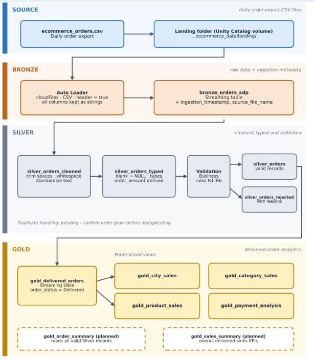

# E-Commerce Sales Data Engineering Pipeline

An end-to-end e-commerce sales data pipeline built on **Databricks** using the **Medallion Architecture** (Bronze → Silver → Gold). Daily order-export CSV files are ingested, preserved raw in Bronze, cleaned and validated in Silver, and aggregated into business-ready datasets in Gold.

> **Status:** Work in progress. Bronze and the initial Silver transformations are implemented; Gold is partially implemented. See [Project Status](#project-status).

## Table of Contents

- [Overview](#overview)
- [Architecture](#architecture)
- [Tech Stack](#tech-stack)
- [Configuration](#configuration)
- [Source Data](#source-data)
- [Bronze Layer](#bronze-layer)
- [Silver Layer](#silver-layer)
- [Gold Layer](#gold-layer)
- [Project Status](#project-status)
- [Implementation Notes](#implementation-notes)
- [Known Issues](#known-issues)
- [Next Steps](#next-steps)

## Overview

| Item | Detail |
|---|---|
| Platform | Databricks Free Edition |
| Approach | Lakeflow Spark Declarative Pipelines (SDP) with Python/PySpark |
| Architecture | Medallion (Bronze → Silver → Gold) |
| Current scope | Bronze implemented, Silver transformations done, Gold partially implemented |

Transformations are written in Python/PySpark. SQL may optionally be used for inspection but is not the primary implementation approach.

## Architecture

```mermaid
flowchart LR
    A[Daily order CSVs<br/>Unity Catalog volume: landing] -->|Auto Loader| B[(Bronze<br/>bronze_orders_sdp)]
    B --> C[Silver: clean & type<br/>silver_orders_cleaned → silver_orders_typed]
    C --> D[(silver_orders)]
    C --> E[(silver_orders_rejected)]
    D --> F[gold_delivered_orders]
    F --> G[gold_city_sales]
    F --> H[gold_category_sales]
    F --> I[gold_product_sales]
    F --> J[gold_payment_analysis]
    D -.planned.-> K[gold_order_summary]
    D -.planned.-> L[gold_sales_summary]

```


| Layer | Purpose | Tables |
|---|---|---|
| Bronze | Raw source records plus ingestion metadata | `bronze_orders_sdp` |
| Silver | Cleaned, standardized, typed, validated records | `silver_orders`, `silver_orders_rejected` |
| Gold | Business aggregates and KPIs | `gold_city_sales`, `gold_category_sales`, `gold_product_sales`, `gold_payment_analysis`, `gold_order_summary`, `gold_sales_summary` |

## Tech Stack

| Component | Used for |
|---|---|
| Databricks Free Edition | Development and execution platform |
| Lakeflow Spark Declarative Pipelines (SDP) | Declarative definition and management of pipeline tables |
| Apache Spark / PySpark | Transformation logic |
| Auto Loader (`cloudFiles`) | Incremental file ingestion from the landing folder |
| Delta tables | Storage, managed by the Lakeflow pipeline |
| Unity Catalog volume | Landing location for CSV files |

## Configuration

| Setting | Value |
|---|---|
| Catalog | `workspace` |
| Schema | `default` |
| Volume path | `/Volumes/ecommerce_sdp/ecommerce_data` |
| Landing folder | `/Volumes/ecommerce_sdp/ecommerce_data/landing` |
| Source CSV | `ecommerce_orders.csv` |
| Pipeline name | `Ecommerence_ETL_SDP` |
| Bronze source file | `01_bronze_layer.py` |
| Bronze validation notebook | `02_bronze_validation` |
| Silver transformation file | `02_silver_layer.py` |

## Source Data

Bronze keeps all source columns as strings. Silver converts types as shown.

| Column | Bronze type | Silver type |
|---|---|---|
| `order_id` | String | String |
| `order_date` | String | Date |
| `customer_id` | String | String |
| `customer_name` | String | String |
| `city` | String | String |
| `product_name` | String | String |
| `category` | String | String |
| `quantity` | String | Integer |
| `unit_price` | String | Decimal(12,2) |
| `payment_mode` | String | String |
| `order_status` | String | String |

Silver also derives `order_amount` = `quantity × unit_price` as `Decimal(18,2)`.

## Bronze Layer

Ingests CSV files from the landing folder using Auto Loader and preserves source values without business cleaning.

- **Source:** `/Volumes/ecommerce_sdp/ecommerce_data/landing`
- **Target:** `bronze_orders_sdp`

```python
from pyspark import pipelines as dp
from pyspark.sql.functions import current_timestamp, col

SOURCE_PATH = "/Volumes/ecommerce_sdp/ecommerce_data/landing"

@dp.table(
    name="bronze_orders_sdp",
    comment="Raw e-commerce order data ingested using Auto Loader"
)
def bronze_orders_sdp():
    raw_df = (
        spark.readStream
        .format("cloudFiles")
        .option("cloudFiles.format", "csv")
        .option("header", "true")
        .option("cloudFiles.inferColumnTypes", "false")
        .load(SOURCE_PATH)
    )
    return (
        raw_df
        .withColumn("ingestion_timestamp", current_timestamp())
        .withColumn("source_file_name", col("_metadata.file_path"))
    )
```

**Design points**

- Auto Loader reads new CSV files from the landing directory.
- Header is enabled and all fields are retained as strings.
- `ingestion_timestamp` records when a record was ingested; `source_file_name` captures the source file path.
- The function returns a streaming DataFrame; Lakeflow manages table writing and pipeline state.

**Acceptance checks**

- Row count reconciles with the number of source CSV records ingested.
- All original source columns are present and unchanged.
- `ingestion_timestamp` and `source_file_name` are populated.
- Table is queryable as `workspace.default.bronze_orders_sdp`.
- A second-file test verifies incremental discovery on a later pipeline update.

## Silver Layer

Reads the Bronze streaming table and prepares the data.

**Processing sequence**

1. Read the Bronze streaming table.
2. Trim leading/trailing spaces and normalize repeated whitespace.
3. Standardize descriptive text fields.
4. Convert blank strings to `NULL` for fields subject to validation.
5. Convert `order_date` to DATE, `quantity` to INT, `unit_price` to DECIMAL(12,2).
6. Derive `order_amount`.
7. Create intermediate tables to inspect each stage.

**Intermediate tables**

| Table | What it does |
|---|---|
| `silver_orders_cleaned` | Trims/normalizes whitespace; `initcap` on name, city, product, category and status; `upper` on payment mode |
| `silver_orders_typed` | Blank-to-NULL; safe type conversion (`try_cast`, `try_to_timestamp` accepting `dd/MM/yyyy` and `yyyy-MM-dd`); derives `order_amount` |

**Business validation rules**

Invalid records go to `silver_orders_rejected` with one or more rejection reasons; valid records go to `silver_orders`.

| Rule | Field | Requirement |
|---|---|---|
| R1 | `order_id` | Must not be NULL or empty |
| R2 | `order_date` | Must be a valid date |
| R3 | `quantity` | Must be greater than zero |
| R4 | `unit_price` | Must be greater than zero |
| R5 | Required fields | `customer_id`, `product_name`, `category`, `city`, `payment_mode` must not be empty |
| R6 | `order_status` | Must be one of Delivered, Shipped, Pending, Cancelled, Returned |

`customer_name` is allowed to be empty per the current project specification.

## Gold Layer

Converts validated Silver records into business-ready datasets using PySpark aggregations in SDP.

| Object | Type | Purpose |
|---|---|---|
| `gold_delivered_orders` | Streaming table from Silver | Reusable input containing only Delivered records |
| `gold_city_sales` | Materialized view | Per-city delivered order count, revenue, average order value, revenue rank |
| `gold_category_sales` | Materialized view | Per-category order count, units sold, revenue, average order value, rank |
| `gold_product_sales` | Materialized view | Per-product order-record count, units sold, revenue, average selling price, rank |
| `gold_payment_analysis` | Materialized view | Per-payment-mode order count, revenue, average transaction value, rank |
| `gold_order_summary` | *Planned* | Order lifecycle and status distribution across all valid Silver records |
| `gold_sales_summary` | *Planned* | Overall business KPIs and delivered sales summary |

**Business rule:** Revenue-based Gold analysis uses **Delivered orders only**. Cancelled, Returned, Pending and Shipped records are excluded from delivered revenue but remain in Silver and are intended for the order lifecycle summary. This keeps non-delivered orders from inflating revenue while preserving operational visibility.

**Validation**

```python
display(spark.read.table("workspace.default.gold_city_sales").orderBy("revenue_rank"))
display(spark.read.table("workspace.default.gold_category_sales").orderBy("revenue_rank"))
display(spark.read.table("workspace.default.gold_product_sales").orderBy("revenue_rank"))
display(spark.read.table("workspace.default.gold_payment_analysis").orderBy("revenue_rank"))
```

- **Revenue reconciliation:** `total_revenue` summed across the city, category, product and payment aggregations should equal total `order_amount` in `gold_delivered_orders`, provided grouping dimensions are populated for every delivered record. If not, investigate the records rather than assuming totals match.
- **Metric interpretation:** `count("*")` counts delivered order *records*, not necessarily distinct order IDs. If the source grain is order-line level, use `countDistinct("order_id")` where unique orders are required. Units sold should continue to use `sum(quantity)`.

## Project Status

| Layer | Work item | Status |
|---|---|---|
| Bronze | Auto Loader ingestion code | Code provided; confirm at runtime |
| Bronze | Metadata columns | Code provided; confirm non-null |
| Bronze | Row-count and schema validation | Steps provided; results not yet recorded |
| Silver | String cleaning, standardization, blank-to-NULL | Code provided |
| Silver | Data type conversion | Code provided; confirm successful pipeline run |
| Silver | Business validation (R1–R6) | Rules defined; validation code not yet included |
| Silver | Duplicate handling | Pending; confirm order grain first |
| Silver | `silver_orders`, `silver_orders_rejected` | Created (confirmed) |
| Gold | `gold_delivered_orders` | Code provided; run not confirmed |
| Gold | `gold_city_sales` | Code provided; run not confirmed |
| Gold | `gold_category_sales` | Code provided; run not confirmed |
| Gold | `gold_product_sales` | Code provided; run not confirmed |
| Gold | `gold_payment_analysis` | Code provided; run not confirmed |
| Gold | `gold_order_summary` | Not implemented |
| Gold | `gold_sales_summary` | Not implemented |

This document records implementation steps and code supplied so far; it does not claim every pipeline update or validation has succeeded.

## Implementation Notes

- A batch table `bronze_orders` may already exist. The SDP implementation uses `bronze_orders_sdp` to avoid collisions.
- Target catalog and schema are `workspace` and `default`.
- Do **not** place manual checkpoint or schema-tracking folders inside the landing directory.
- Do not drop or overwrite existing tables without checking dependencies and confirming the target.
- Deduplication must use the true business grain. If an order can contain multiple product lines, `order_id` alone is not a safe unique key.

## Known Issues

Inconsistencies spotted in the current code and configuration, worth fixing before running the full pipeline:

- **Catalog naming:** Code references `workspace`, `ecommerce_sdp` and `ecommerence_sdp` (typo) as catalogs in different places. Standardize on the configured `workspace.default`.
- **Pipeline name typo:** `Ecommerence_ETL_SDP`.
- **Whitespace regex:** `silver_orders_cleaned` uses `r"\\s+"`, which as a raw string matches a literal backslash followed by `s`, not whitespace. It should likely be `r"\s+"`.
- **Gold source table:** `gold_delivered_orders` reads from `silver_orders_cleaned`, not the final `silver_orders`, so it bypasses validation.
- **`gold_city_sales`:** Revenue and average order value use `unit_price` instead of `order_amount`.
- **`gold_category_sales`:** Revenue and average order value are computed from `order_id` (`sum("order_id")`, `avg("order_id")`) instead of `order_amount`.

## Next Steps

**Pipeline and Silver**

1. Run the pipeline and confirm `silver_orders_typed` is created.
2. Inspect schema and sample rows in `silver_orders_typed`.
3. Apply the six business validation rules.
4. Generate rejection reasons and split valid vs. rejected records.
5. Confirm the order grain and implement safe duplicate handling.
6. Reconcile Bronze count against valid, rejected and duplicate counts.

**Gold**

1. Build `gold_order_summary` from all valid Silver records (counts by status and lifecycle metrics).
2. Build `gold_sales_summary` for overall delivered sales KPIs.
3. Run the full pipeline and confirm all Gold datasets are created and refreshed.
4. Validate totals and reconcile Gold revenue against `gold_delivered_orders`.
5. Decide whether order counts mean order records or distinct order IDs, based on source grain.
